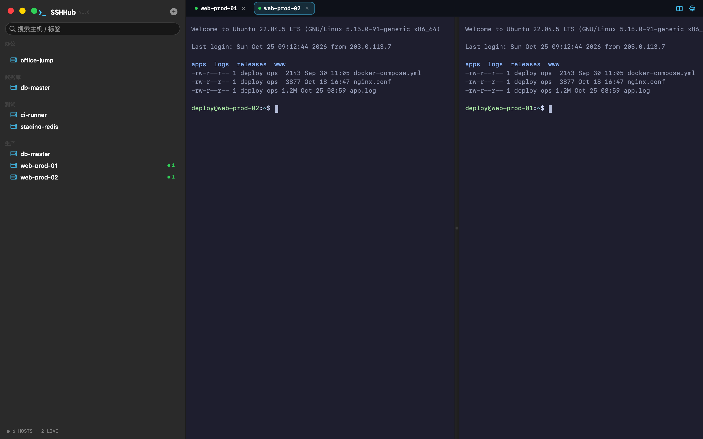
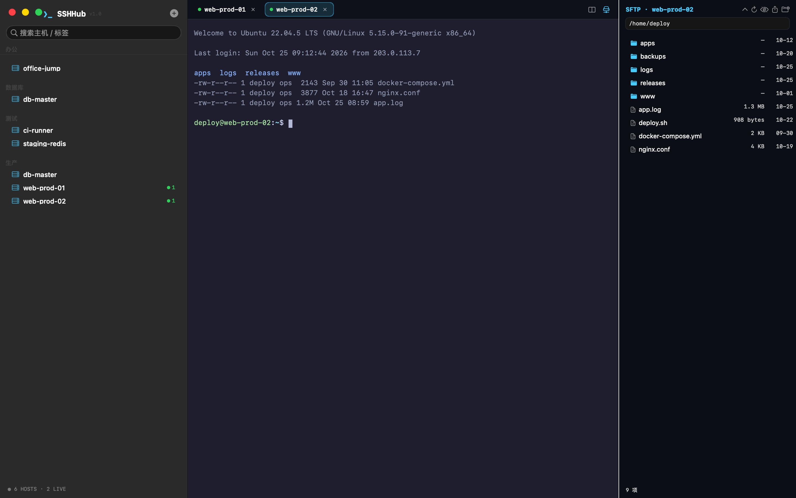
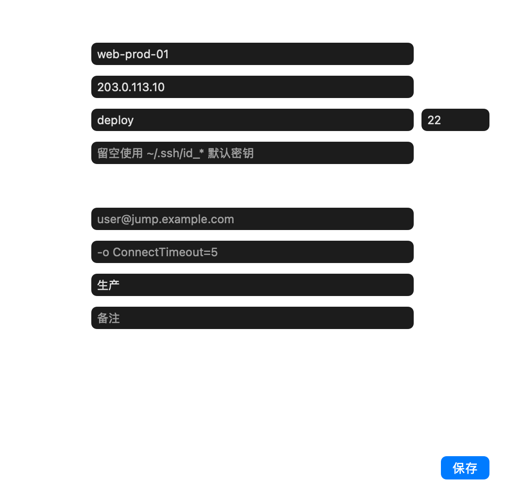
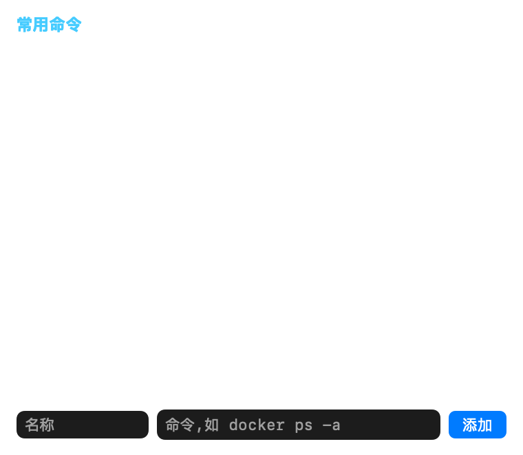
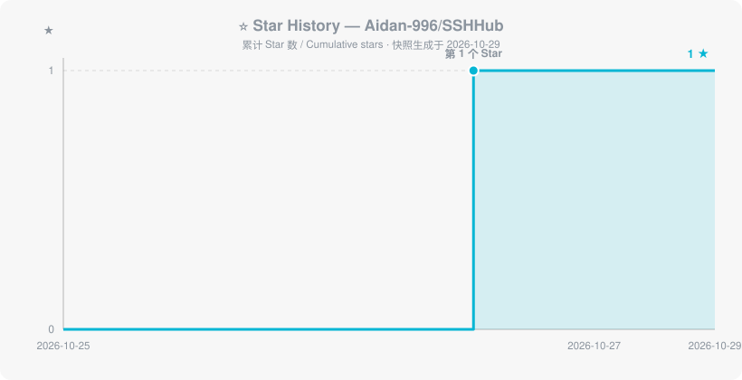

# ❯_ SSHHub

**Mac 原生 SSH 终端管理工具 · Native SSH terminal manager for macOS**

**🌐 官网 / Site**: <https://aidan-996.github.io/SSHHub-Release/> · **⬇️ 下载 / Download**: [Latest Release](https://github.com/Aidan-996/SSHHub-Release/releases/latest)

---

## ✨ 功能亮点 / Highlights

- **主机管理** — 分组标签、搜索、一键导入 `~/.ssh/config`
- **多标签终端** — 每标签独立 ssh 进程,切换不断线;⌘D 最多 4 窗格分屏
- **本地终端** — ＋ 菜单一键打开本机登录 shell,不连服务器
- **多会话同步输入**(⌘⇧B)— 广播模式:任意窗格敲命令,所有窗格同步执行
- **内置 SFTP**(⌘I)— 自实现 SFTP v3 协议零依赖:上传/下载/改名/建目录,Finder 拖拽上传
- **分屏工作区** — 保存会话与窗格布局,一键整组恢复
- **端口转发**(⌘P)— `-L / -R / -D` 隧道后台常驻,规则持久化、自动恢复
- **命令面板**(⌘⇧P)+ **快速连接**(⌘K,支持 `user@host:port` 与 IPv6)
- **断线自动重连** · **mosh 支持** · **会话日志自动落盘** · **6 套主题**
- **密钥托管** — 导入私钥 / 一键生成 ED25519;密码可存 macOS 钥匙串
- **应用内更新** — 自动检查新版本一键升级

> SSH 引擎直接使用系统 `/usr/bin/ssh`:密钥、Agent、跳板机、known-hosts 行为与命令行完全一致,应用不碰你的凭据。

## 💰 免费版与 Pro / Free & Pro

| 能力 / Capability | FREE(当前版本) | PRO(规划中) |
|---|:---:|:---:|
| 多标签终端 · 4 窗格分屏 / Tabs & split panes | ✅ | ✅ |
| 多会话同步输入(⌘⇧B)/ Broadcast input | ✅ | ✅ |
| 本地终端(＋ 菜单)/ Local shell | ✅ | ✅ |
| 内置 SFTP(自实现 v3,零依赖)/ Built-in SFTP | ✅ | ✅ |
| 端口转发 -L / -R / -D / Port forwarding | ✅ | ✅ |
| 分屏工作区 · 命令面板 · 片段 / Workspaces, palette, snippets | ✅ | ✅ |
| 6 套主题 · 会话日志 · 自动重连 / Themes, logging, auto-reconnect | ✅ | ✅ |
| 备份迁移 · 应用内更新 / Backup & in-app updates | ✅ | ✅ |
| 批量命令执行(多机并行,输出聚合)/ Batch command execution | — | 🧭 |
| 会话录制回放(asciinema 兼容)/ Session replay | — | 🧭 |
| Zmodem 拖传(rz/sz)/ Zmodem transfers | — | 🧭 |
| 配置云同步(端到端加密,团队共享)/ Encrypted cloud sync | — | 🧭 |
| AI 命令助手(报错解释 / 修复建议)/ AI command assistant | — | 🧭 |
| 优先技术支持 / Priority support | 社区 / Community | 🧭 |

> **说明**:免费版**永久免费**;Pro 为规划中的功能方向,不代表已上线,发布节奏以 [Releases 公告](https://github.com/Aidan-996/SSHHub-Release/releases)为准。

## 📸 截图 / Screenshots

**主窗口 · 多标签 + 左右分屏 / Main window · tabs + split panes**

**SFTP 文件面板 / SFTP file panel**

**端口转发 / Port forwarding** · **主机编辑 / Host editor**

  
  

**命令片段 / Command snippets**

## ⭐ Star History

## 📜 版本说明 / License Note

v1.4.0 及更早的公开版本遵循 MIT;此后的版本不再公开源码,仅通过本仓库分发二进制。
v1.4.0 and earlier public releases are MIT-licensed; later versions are distributed as binaries only via this repository.

## 🐛 问题反馈 / Feedback

欢迎到 [Issues](https://github.com/Aidan-996/SSHHub-Release/issues) 提交问题与建议。
